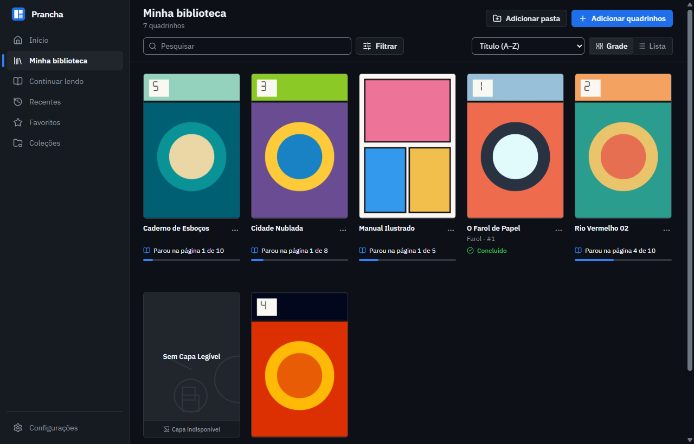
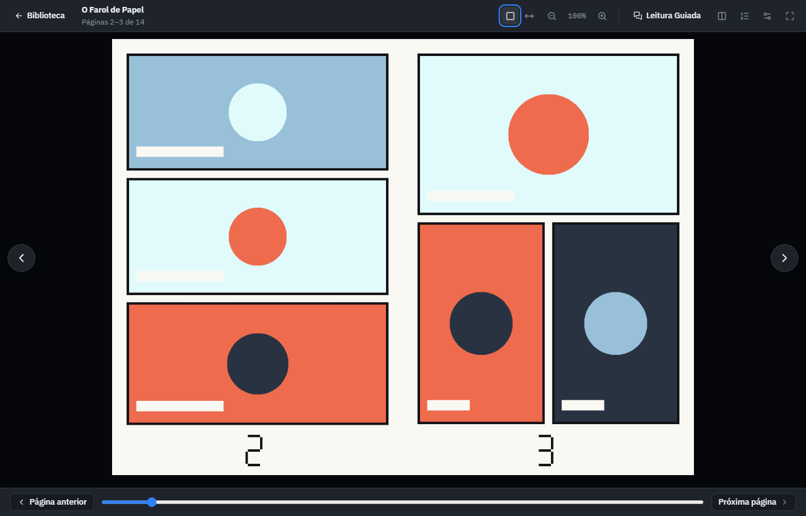
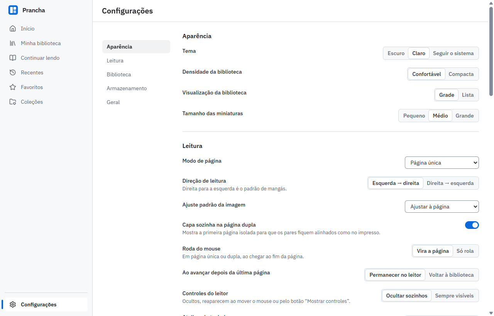

<p align="center">
  
</p>

<h1 align="center">Prancha</h1>

<p align="center">
  Leitor e organizador de quadrinhos, mangás e graphic novels para Windows.<br />
  Funciona sem conta, sem internet e sem assinatura.
</p>

<p align="center">
  <a href="https://cakeysama.github.io/prancha/"><strong>Baixar</strong></a>
  ·
  <a href="https://prancha-beta.vercel.app">Site oficial</a>
  ·
  <a href="https://github.com/CAKeysama/prancha/releases">Todas as versões</a>
  ·
  <a href="CHANGELOG.md">Novidades</a>
</p>

<p align="center">
  <a href="https://github.com/CAKeysama/prancha/releases/latest"></a>
  <a href="https://github.com/CAKeysama/prancha/actions/workflows/ci.yml"></a>
  <a href="LICENSE"></a>
</p>



## Funcionalidades

- **Formatos testados:** CBZ, CBR (RAR4/RAR5 via UnRAR), CB7, CBT, PDF e pastas com imagens (JPEG, PNG, WebP, GIF, BMP; AVIF exibido no leitor).
- **Biblioteca:** capas automáticas (metadados → imagem de capa → primeira página válida → capa substituta identificada), pesquisa sem acentos, filtros, ordenação, grade/lista, favoritos e coleções.
- **Leitor:** página única, dupla, rolagem vertical e modo webtoon, em coluna estreita e contínua; ajustar à página/largura/altura; zoom; direita→esquerda; tela cheia; índice de páginas; atalhos configuráveis; progresso salvo automaticamente.
- **Leitura Guiada:** a página fica inteira e cada balão salta para fora, maior, na ordem de leitura. A detecção roda no próprio computador, e o que estiver errado pode ser corrigido à mão.
- **Fontes de leitura, um plugin opcional:** instale pela aba Plugins. Repositórios próprios com assinatura e confiança explícita, extensões em WebAssembly isolado, pesquisa em Explorar e leitura capítulo por capítulo, sem baixar. As obras entram em favoritos e coleções, aparecem no Início e guardam onde você parou. O que você decidir baixar vira CBZ na biblioteca e abre sem internet. O Prancha não vem com fontes instaladas, e o único repositório publicado pelo projeto é uma [demonstração com obras originais](docs/extensions/README.md#repositório-de-demonstração). Extensões são código de terceiros: leia o [guia](docs/extensions/README.md). Repositórios do Mihon no formato do Keiyoushi [funcionam pelo Suwayomi](docs/extensions/COMPATIBILITY.md), baixado na primeira instalação e sem o isolamento do Prancha.
- **Tutorial** de primeira execução com importação real.

| Leitor | Configurações |
|---|---|
|  |  |

Mais capturas em [`artifacts/screenshots/`](artifacts/screenshots/).

## Instalação

Baixe a versão mais recente na [página de downloads](https://cakeysama.github.io/prancha/) ou em [Releases](https://github.com/CAKeysama/prancha/releases/latest), e abra o instalador.

| Arquivo | Para quem |
|---|---|
| `Prancha_X.Y.Z_x64-setup.exe` | Recomendado. Instala só para o seu usuário e não exige administrador. |
| `Prancha_X.Y.Z_x64_pt-BR.msi` | Instala para todos os usuários do computador e exige administrador. |

Os instaladores não têm assinatura digital, então o Windows SmartScreen pode pedir confirmação na primeira execução. Cada release traz os SHA-256 para conferir o download.

### Atualizações

A partir da 0.2.0, o Prancha procura versões novas ao abrir e pergunta antes de instalar. A biblioteca e o progresso são mantidos. Quem está na 0.1.x precisa instalar a 0.2.0 por cima uma vez.

Para isso, ele lê o arquivo `latest.json` da release mais recente no GitHub e, nas configurações, o histórico de versões. Nenhum dado da sua biblioteca é enviado. Sem internet, ele abre e funciona normalmente.

### Requisitos

- Windows 10 ou 11 de 64 bits. Por enquanto, o Windows é o único sistema com instalador.
- WebView2, que já vem no Windows 11. Se faltar, o instalador baixa.

## Desenvolvimento

### Pré-requisitos

| Ferramenta | Versão usada | Observação |
|---|---|---|
| Windows | 10/11 x64 | WebView2 já vem no Windows 11 |
| Node.js | 22.13+ | npm 10+ |
| Rust | stable (1.95+) | via [rustup](https://rustup.rs), com `rustup target add wasm32-unknown-unknown` para os testes de extensões |
| Visual Studio Build Tools | 2022 | workload "Desenvolvimento para desktop com C++" + Windows 11 SDK (o UnRAR e o SQLite são compilados em C/C++) |

> **Caminhos longos:** se a pasta do projeto tiver um caminho muito longo, o linker do Windows
> pode falhar (limite de 260 caracteres). Use uma pasta de build curta:
> `set CARGO_TARGET_DIR=C:\Users\<você>\.cache\prancha-target` (PowerShell: `$env:CARGO_TARGET_DIR=...`).

### Executar

```bash
npm install
npm run tauri dev
```

O frontend roda em `http://localhost:1420` com recarga automática; o backend Rust é recompilado ao salvar.
Os dados ficam em `%APPDATA%\app.prancha.desktop`. Para usar outra pasta (testes, modo portátil):
`PRANCHA_DATA_DIR=C:\caminho\dados`.

### Testes

```bash
npm run typecheck      # TypeScript estrito
npm run lint           # ESLint (+ regras do React Compiler)
npm test               # Vitest: regras de domínio e componentes (IPC simulado)
npm run test:rust      # cargo test: formatos, importação, capas, catálogo, progresso, detecção, extensões
npm run e2e:build      # compila o app de depuração e gera os arquivos de teste
npm run test:e2e       # Playwright no executável real (WebView2 via CDP) + capturas de tela
npm run test:update    # atualização real entre duas versões instaladas, com servidor local
```

Gerar os instaladores pede a chave de assinatura das atualizações ([`docs/RELEASING.md`](docs/RELEASING.md)). Para compilar sem ela:

```bash
npm run tauri build -- --config "{\"bundle\":{\"createUpdaterArtifacts\":false}}"
```

Os arquivos de teste são gerados por `src-tauri/examples/make_fixtures.rs` (desenhos geométricos
próprios; nenhum quadrinho comercial no repositório). Resultados: [`docs/TEST_REPORT.md`](docs/TEST_REPORT.md).

Os testes da Leitura Guiada só rodam com páginas reais: os quadrinhos ficam no seu disco e o gabarito em
`tests/real/manifest.json`, fora do git. Sem esse arquivo esses testes falham de propósito, para ninguém
achar que a detecção foi conferida. As capturas deles vão para `tests/real/screenshots/`, também fora do git.
Por isso, o GitHub Actions roda só as demais verificações, e estes testes rodam localmente antes de cada versão.

### Compilação e instalador

```bash
npm run tauri build
```

Gera, em `<target>/release/bundle/`:

- `nsis/Prancha_X.Y.Z_x64-setup.exe` — instalador por usuário (não exige administrador), em português;
- `msi/Prancha_X.Y.Z_x64_pt-BR.msi` — pacote MSI.

O instalador baixa o WebView2 se ele não estiver presente.

### Renomear o aplicativo

O nome está centralizado em dois pontos: `src/app/config.ts` (`APP_NAME`, usado em toda a interface)
e `src-tauri/tauri.conf.json` (`productName` e `app.windows[0].title`, usados no executável e no instalador).

## Estrutura do projeto

| Pasta | Conteúdo |
|---|---|
| `src/` | Interface em React: `features/` (biblioteca, leitor, tutorial, configurações), `domain/` (regras sem interface), `services/` e `components/` |
| `src-tauri/` | Backend em Rust: formatos, importação, capas, banco de dados, em `src/guided/` a detecção da Leitura Guiada e em `src/extensions/` repositórios, runtime, fontes e downloads |
| `extensions/` | Contrato WIT, SDK, modelo, ferramenta `prancha-ext` e a extensão e o repositório de demonstração |
| `site/` | Site oficial, publicado na Vercel |
| `scripts/` | Geração do site, da página de downloads, das notas de versão e das licenças de terceiros |
| `tests/` | Testes de interface (`unit/`) e no executável real (`e2e/`) |
| `docs/` | [Arquitetura](docs/ARCHITECTURE.md), [extensões](docs/extensions/README.md), [relatório de testes](docs/TEST_REPORT.md), [como publicar uma versão](docs/RELEASING.md) e [plano de implementação](docs/IMPLEMENTATION_PLAN.md) |

## Versões

O projeto segue o [versionamento semântico](https://semver.org/lang/pt-BR/): `PATCH` para correções, `MINOR` para funcionalidades compatíveis e `MAJOR` para mudanças incompatíveis. O que mudou em cada versão está no [`CHANGELOG.md`](CHANGELOG.md) e em [Releases](https://github.com/CAKeysama/prancha/releases). Para publicar uma versão, veja [`docs/RELEASING.md`](docs/RELEASING.md).

## Licença

Código do Prancha: [MIT](LICENSE). A lista completa de componentes de terceiros fica em
Configurações › Geral › Licenças de terceiros (gerada por `npm run licenses`).
A leitura de CBR usa o código-fonte do **UnRAR**, de Alexander Roshal, sem modificações, sob esta condição:

> UnRAR source code may be used in any software to handle RAR archives without limitations free of charge,
> but cannot be used to develop RAR (WinRAR) compatible archiver and to re-create RAR compression algorithm,
> which is proprietary. Distribution of modified UnRAR source code in separate form or as a part of other
> software is permitted, provided that full text of this paragraph, starting from "UnRAR source code" words,
> is included in license, or in documentation if license is not available, and in source code comments of
> resulting package.
